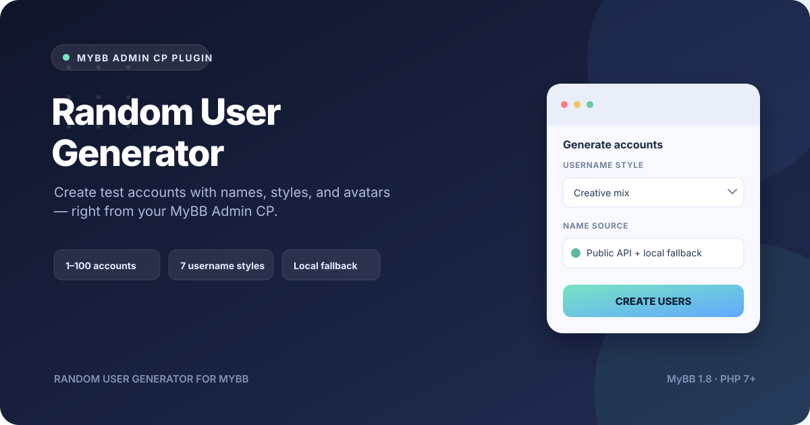

# Random User Generator for MyBB

  

An Admin CP tool that creates real MyBB accounts with random usernames. Names can come from public name APIs or a built-in local list when an API is unavailable. Generated accounts receive a password, a derived email address, and an optional DiceBear avatar.

- **Version:** 1.1.0
- **Compatibility:** MyBB 1.8.x
- **Requirements:** PHP 7.0+; cURL recommended; `iconv` required for transliteration
- **License:** GPL-3.0

## Features

- Generate **1–100 users** in one request.
- Choose from **seven username styles**: local name, fancy name, single word, two words, multi-word, name plus number, or creative mix.
- Select a name source: Random User API, UI Names API, Faker API, or a custom JSON endpoint.
- Automatically fill missing names from a local first/last-name list when a name request fails.
- Select the target usergroup and optionally set a maximum username length.
- Choose from six DiceBear avatar styles; avatars are stored as remote URLs.
- Generate passwords with MyBB's `random_str()`.
- Review generated accounts in a dedicated history table; each account also gets an admin log entry and an Edit link.

## Installation

1. Copy the repository contents into your MyBB forum root.
2. In **Admin CP → Configuration → Plugins**, install and activate **Random User Generator**.
3. Configure it under **Configuration → Settings → Random User Generator**.
4. Open **Users and Groups → Random User Generator** to create accounts.

The plugin adds the `user/random_user_generator` permission under **Users and Groups**. The installer creates a `{TABLE_PREFIX}random_user_generator_history` table. Uninstalling drops that table and removes the plugin settings; generated user accounts are not removed.

## Name sources and fallback

The plugin offers Random User API, UI Names API, Faker API, and a custom JSON endpoint option. The custom endpoint is expected to return top-level `first`, `last`, `name`, or `surname` fields. If the selected source fails or returns too few names, local names fill the requested batch.

> **Current implementation note:** batch generation calls the Random User and Faker APIs. The UI Names and custom API choices currently fall back to local names instead of making a request. API errors are not shown in the Admin CP.

## Important security and behavior notes

This plugin creates real accounts and should only be used on forums where you are authorized to do so. Review and test it in a non-production environment first.

The current implementation has known limitations: generated passwords are stored and displayed in plain text in the history; TLS certificate verification is disabled for outbound API requests; and the chosen target usergroup is not validated by the plugin. The custom API URL is also unrestricted. Restrict Admin CP access accordingly and do not use this plugin with untrusted administrators or endpoints.

Other documented behavior includes a maximum batch of 100 accounts per request, no welcome email despite the setting, and no removal of generated users during uninstall.

## License

GPL-3.0. See [LICENSE](LICENSE).
